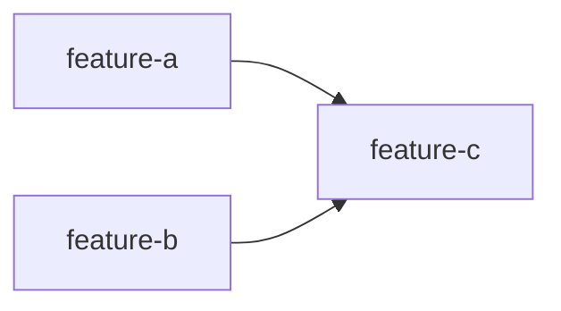

# Technical Design Doc Creator

Creates Technical Design Documents following industry patterns (Google Design Docs, RFC, ADR, SRE book, OWASP, PCI DSS). Human-readable overview: [README.md](README.md).

## Core principle: architecture, not implementation

TDDs document **decisions and contracts**, not code. The doc must survive a framework swap (NestJS → Express, TypeORM → Prisma).

| Include | Avoid |
|---------|-------|
| API contracts (endpoint, method, request/response schema) | CLI commands, curl examples |
| Data schemas (tables, fields, indexes) | ORM entities, decorators, code snippets |
| Component responsibilities and data flow (Mermaid diagrams) | File paths, framework-specific syntax |
| Strategies ("rollback via feature flag") | Tool-specific rollback commands |
| Technology decisions with rationale | Vendor SDK usage details |

Litmus tests: *"If we change frameworks, does this still apply?"* (yes → include). *"Can someone implement this differently and still meet the requirement?"* (yes → document the requirement, not the implementation).

## Language

All text and documents this skill creates must be written in **English**, even when the prompt, plan, or source document is in another language. Product names, paths, identifiers, and quoted user answers stay verbatim.

## Work item type: feature or fix

The skill handles two kinds of work item. Planning and implementation are the same for both; **only the Context Pillars (the verbatim source) differ.**

| Type | What it is | Context Pillars | Source of the answers |
|------|------------|-----------------|-----------------------|
| **Feature** | New or changed product capability | 4 questions | `docs/harness/features/feature-{name}.md`, or the user |
| **Fix** | Issue / ticket / task that corrects code without necessarily changing a feature | 2 questions | Problem: the user **or** the originating card/ticket/task. Solution: the user, or the place the user points to |

Determine the type **before anything else**, in this order:

1. The user states it ("TDD for feature X", "design doc for bug/issue/ticket Y").
2. It can be inferred without ambiguity: a `feature-{name}.md` exists → feature; a ticket/card/issue describing a defect or correction is given → fix.
3. Otherwise **ask first via AskQuestion** ("Is this design doc for a feature or a fix?") — never assume.

## Sections

**Mandatory (1–8)** — if missing, ask via AskQuestion; never skip:

1. **Header & Metadata** — tech lead, team, epic/ticket link, status, dates (table).
2. **Technical Solution** — **always the second section, right below the header**, so stakeholders start reading from the decision taken and get the context afterwards. Architecture overview + diagram, data flow steps, API endpoint table with example request/response, database changes + migration strategy.
3. **Context Pillars** — **always the third section; the TDD cannot be written without it.** Content depends on the work item type:

   **Feature — 4 pillars.** Reproduces the 4 questions and answers from the feature harness file `docs/harness/features/feature-{name}.md`:
   1. Como descreve a feature?
   2. Qual problema objetivamente ela resolve?
   3. Qual a solução esperada? Quais trade-offs ela envolve?
   4. Qual exemplo ou contexto temos do problema e da solução?

   If the feature file doesn't exist, ask the user the 4 questions via AskQuestion, record the answers verbatim in the TDD, and instruct the user to create `docs/harness/features/feature-{name}.md` before proceeding. The answers always come from the user — the agent never invents or completes them.

   **Fix — 2 pillars.**
   1. **Problem description** — answered by the user **or** copied verbatim from the originating card/ticket/task (Jira, Linear, GitHub issue, etc.). Record the source (ticket key/URL) next to the quote.
   2. **Solution description** — answered by the user. If the user says the answer already exists (ticket comment, PR, doc, message), copy it verbatim from where the user pointed and record the source.

   If either pillar is not available from the user or the referenced source, ask via AskQuestion. The agent never invents, completes or paraphrases either answer.
4. **Context** — 2–4 paragraphs: current state, business domain, stakeholders.
5. **Problem Statement & Motivation** — specific problems with quantified impact; why now; cost of not solving.
6. **Scope** — explicit ✅ In Scope (V1), ❌ Out of Scope, 🔮 Future (V2+); min 3 items each side.
7. **Risks** — table: risk / impact (H·M·L) / probability (H·M·L) / mitigation; minimum 3.
8. **Implementation Plan** — phased task table (see TDD Red/Green rule below).

**Critical (9–12)** — mandatory by project type (see matrix):

9. **Security Considerations** — authn/authz model, encryption at rest + in transit, PII handling and retention, compliance (GDPR/LGPD, PCI DSS), secrets management, webhook signature validation, input validation / rate limiting / audit logging checklist.
10. **Testing Strategy** — test types table (unit, integration, e2e, contract, load) with scope and approach; critical scenarios; test data management.
11. **Monitoring & Observability** — metrics table with alert thresholds; structured JSON log format; what to log and what NEVER to log (secrets, card data, raw PII); alert severity/channel table.
12. **Rollback Plan** — deployment strategy (flag, phased rollout, canary), rollback trigger table, rollback steps as strategy (flag off → revert deploy → down migration → communicate), post-rollback RCA.

**Suggested (13–21)** — offer, don't force: Success Metrics · Glossary · Alternatives Considered (options table + decision criteria) · Dependencies (+ approvals/blockers) · Performance Requirements (latency percentiles, throughput, availability) · Migration Plan (phases, data migration, backward compatibility) · Open Questions (tracked table with owner/status) · Roadmap/Timeline · Approval & Sign-off.

### Criticality matrix

| Project type | Required beyond mandatory |
|--------------|---------------------------|
| Payment, Auth, PII | Security Considerations |
| Any production system | Monitoring & Observability, Rollback Plan |
| External integration | Dependencies, Security |
| All | Testing Strategy (highly recommended) |

### Size adaptation

| Size | Sections |
|------|----------|
| Small (< 1 week) | 1–8 + Testing Strategy |
| Medium (1–4 weeks) | 1–12 + Dependencies + Open Questions |
| Large (> 1 month) | All 21 |

## Implementation Plan uses TDD Red/Green

**Every implementation phase must state that it is executed with test-driven development**: each task starts with a failing test (**Red**), then the minimal code to pass (**Green**), then refactor. Make this explicit in the plan, e.g.:

```markdown
| Phase | Task | TDD cycle | Owner | Estimate |
|-------|------|-----------|-------|----------|
| 2 – Core | SubscriptionService | Red: failing unit tests for create/cancel → Green: minimal service | @Dev2 | 4d |
| 3 – APIs | POST /subscriptions | Red: failing integration test → Green: controller + DTO | @Dev3 | 2d |
```

Do not add a separate trailing "write tests" phase — tests lead each phase, they don't follow it. Execution follows the [`tester`](../tester/SKILL.md) skill.

## Interactive workflow

1. **Determine work item type** — feature or fix, following the order in "Work item type". If not stated and not inferable, AskQuestion first.
2. **Gather** — AskQuestion: project name, size (S/M/L), type (integration, feature, refactor, infra, payment, auth, data), whether context/problem is already clear.
3. **Collect Context Pillars**
   - *Feature*: locate `docs/harness/features/feature-{name}.md` and copy its 4 questions/answers verbatim. If the file is missing, ask the user the 4 questions via AskQuestion (never answer or complete them yourself), record the answers verbatim, and instruct the user to create the feature file before proceeding.
   - *Fix*: take the Problem description from the user or the originating card/ticket/task; take the Solution description from the user or from the place the user points to. Ask via AskQuestion for whatever is not available. Copy verbatim, record sources.
4. **Choose design pattern (mandatory AskQuestion)** — *Feature*: present as options the design patterns listed in the feature file's "Design Patterns (Gang of Four) Sugerido" section. *Fix*: present the pattern(s) already used by the code being corrected plus "keep existing structure (no new pattern)". Ask which one the user wants for this implementation and record the choice in the Technical Solution section. Never pick for the user.
5. **Validate mandatory info** — ask for anything missing: problem (what/why now/impact if not), scope in/out, high-level approach and components, ≥3 risks, phase breakdown with owners.
6. **Enforce critical sections** by project type (matrix above). For payment/auth: ask authn model, encryption, PII, compliance. For production: metrics, alerts, rollback triggers and steps.
7. **Offer suggested sections** — user can add now or later.
8. **Generate** the Markdown doc; validate with the checklist below; report included/missing sections and next steps.
9. **Offer publication** — Confluence page (via Confluence/Atlassian skill or MCP) if available.

Ask instead of guessing. Vague answers get one targeted follow-up, then an explicit `TBD` in the doc.

## Output location

Every TDD is AI-generated, so it goes under `especs/design-docs/` — never under `docs/`:

- Feature: `especs/design-docs/tdd-feature-{name}.md`, derived from `docs/harness/features/feature-{name}.md`.
- Fix: `especs/design-docs/tdd-fix-{name}.md` (use the ticket key when there is one, e.g. `tdd-fix-PROJ-123.md`), derived from the originating card/ticket/task and the user's answers.

## Multi-item mode — `especs/design-docs/implementation.md`

Triggered whenever the run covers **more than one work item** — features, fixes or a mix (several `docs/harness/features/feature-{name}.md`, several tickets, or the user asks for TDDs for multiple items at once). Beyond one TDD per item, generate `especs/design-docs/implementation.md` with the implementation waves. Everything below that says "feature" applies equally to fixes.

- Run the full workflow **per item** (Context Pillars and design pattern asked one item at a time); write the TDDs into `especs/design-docs/` next to `implementation.md`.
- `implementation.md` is derived from the feature harness files / originating tickets and the generated TDDs — never invent features, fixes, dependencies or scope.
- **Wave** = set of features that can be implemented **in parallel by independent agents**: complementary scope, no writes to the same files/modules/tables, and no dependency on an artifact produced by another feature of the same wave.
- Any dependency (schema, API contract, shared module, migration, feature flag) pushes the dependent feature to a **later** wave.
- Each feature in a wave is one **agent lane** with an explicit ownership boundary (paths/modules it may touch), so lanes never collide.
- Waves are sequential: wave N+1 starts only after every lane of wave N is merged and green.
- **Conflict rule**: two features in the same wave that must write the same file, table or contract → merge them into a single lane or move one to the next wave. Never leave a shared write inside a parallel wave.
- Each feature row links to its TDD; the Red/Green rule of each TDD Implementation Plan still governs execution.

Template:

````markdown
# Implementation Waves

| Wave | Features | Parallel agents | Blocked by |
|------|----------|-----------------|------------|
| 1 | feature-a, feature-b | 2 | — |
| 2 | feature-c | 1 | Wave 1 |

## Wave 1 — <goal of the wave>

| Feature | TDD | Agent lane (owned paths/modules) | Depends on | Shared touchpoints |
|---------|-----|----------------------------------|------------|--------------------|
| feature-a | [TDD](tdd-feature-a.md) | `src/billing/**` | — | `db/migrations` (serialized within the wave) |
| feature-b | [TDD](tdd-feature-b.md) | `src/notifications/**` | — | — |

**Exit criteria:** all lanes green (Red/Green per TDD Implementation Plan), no conflicting migrations, contracts published.

## Dependency graph


````

## Validation checklist

- [ ] Header: tech lead, team, epic link
- [ ] Work item type (feature or fix) stated by the user, inferred unambiguously, or asked via AskQuestion
- [ ] Context Pillars — feature: 4 answers present, sourced from `feature-{name}.md` or answered by the user; fix: Problem (user or originating ticket) and Solution (user or the source the user pointed to), both verbatim with source recorded
- [ ] Design pattern: chosen by the user via AskQuestion (feature: among the patterns suggested in the feature file; fix: existing pattern or "keep existing structure"), recorded in Technical Solution
- [ ] Problem: ≥2 specific problems with impact
- [ ] Scope: ≥3 in-scope and ≥3 out-of-scope items
- [ ] Solution: diagram or component description + ≥1 API contract
- [ ] Risks: ≥3 with impact/probability/mitigation
- [ ] Plan: phased, estimated, **Red/Green noted per phase**
- [ ] Payment/auth → Security section complete (authn, encryption, PII, compliance)
- [ ] Production → Monitoring (≥3 metrics + alerts) and Rollback (triggers + steps)
- [ ] Testing: ≥2 test types + critical scenarios
- [ ] Multi-item run → `especs/design-docs/implementation.md` with ordered waves, one agent lane per item, dependency graph, and no shared writes inside a wave

## Anti-patterns

- **Assuming the work item type** — when it is not stated and cannot be inferred, ask "feature or fix?" before anything else.
- **TDD without Context Pillars, or with answers invented/completed by the agent** — never; feature answers come from `feature-{name}.md` or directly from the user; fix answers come from the user or the originating ticket / the source the user pointed to.
- **Treating a fix as a feature** — do not ask the 4 feature questions or require `feature-{name}.md` for a fix; the fix has 2 pillars only.
- **Vague problem**: "We need to integrate with Stripe" → quantify: "manual payment processing costs 2h/day (~$500/month); current processor blocks international expansion".
- **Undefined scope**: "all features" → explicit V1 list + explicit exclusions.
- **Payment system without a Security section** — never.
- **No rollback plan for production** — always define triggers (e.g. error rate > 5% for 5 min → flag off) and steps.
- **Implementation-level detail** — commands, code, file paths belong in the repo, not the TDD.
- **Parallel wave with colliding lanes** — two agents writing the same module, migration or contract in the same wave; serialize them instead.
