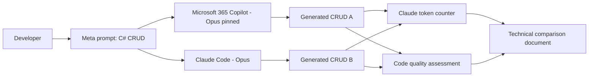

# Copilot Dev Fitness — Schizzo

- Author: BrunoMartino
- Date: 2026-11-19
- Status: reviewed

## Hypothesis
One fixed meta prompt asks for a CRUD in C#. The same prompt is given to Microsoft 365 Copilot and to Claude (Claude Code), both pinned to an Opus model. The generated code is measured on token count, using Claude's token counter for both outputs, against code quality, to produce a technical document showing whether Microsoft 365 Copilot is fit for software development even with Claude models available inside it.

## Problem and success measure
- Pain: a developer uses Microsoft 365 Copilot for development work; the author believes it underperforms dedicated coding tools in answer quality and in consumption, even with Claude API credits available.
- Today: no measured evidence exists; the claim rests on perception.
- Success measure: a technical document with a side-by-side comparison of Copilot 365 versus Claude Code on the same C# CRUD task: tokens counted with the same Claude token counter, and code quality.

## Scope
- Goals: one meta prompt (C# CRUD task) run unchanged in Copilot 365 and in Claude Code; token count of both outputs with Claude's counter; code-quality comparison; technical document.
- Non-goals: deciding on licences or procurement (the author decides afterwards); Cursor (the latest proposal names only Copilot and Claude).
- Hard constraints: the same prompt runs in both tools; both pinned to Opus; the comparison covers both quality and tokens, not tokens alone.

## Context
none (not a code change in this repository).

## Questions and answers
| Question asked | User's answer |
|----------------|---------------|
| Who reads the document, what does success look like, which usage data exists, which Copilot is meant? | "não to te pedindo para me explicar nada, te mandei fazer a pesquisa e criar o meta prompt, eu lido com as decisões eu mesmo depois" |
| Readiness gate (hypothesis as above) | "não é apenas custo, quero qualidade da resposta tambem" — proceed to research |
| (unprompted clarification) | "pode ser um meta-prompt para medir qualidade e custo no copilot e um para para medir no claude tambem, assim posso comparar nivel do código entregue" |
| How to address the open objections (asymmetric cost, self-grading, Cursor)? | "talvez o ideal seja um meta prompt que mande escrever um crud em C#, e passamos para o Copilot e o Claude fazerem, depois medimos quantos tokens o crud gerado usa x qualidade do código gerado, como ambos estão usando modelo opus, podemos usar o medidor do claude para comparar ambos" |

## Research
| Finding | Kind | Source | Signal | Impact on the decision |
|---------|------|--------|--------|------------------------|
| Akita v4 measures only unprompted security vigilance (14 planted CVE sabotages in a Rails app over 7 sprints); cost/time are side columns | tool | akitaonrails.com/en/2026/09/15/new-llm-benchmark-v4-retesting-all-top-llms-part-1/ (blog, 2026-09) | single-author | Cite v4 only as model-capability evidence with its scope stated; it cannot anchor everyday-dev quality |
| v4 ranks models, not tools; Cursor and M365 Copilot are not benchmarked; Claude ran on a Max plan (notional cost) vs per-token for others | pitfall | same + akitaonrails.com/en/2026/10/28/... (blog, 2026-10) | single-author | Tool-level verdict must come from the developer's own paired measurement, not from v4 |
| No independent M365 Copilot vs Claude Code/Cursor coding benchmark exists; comparisons are vendor/affiliate pages | solution | contextstudios.ai/comparisons/microsoft-365-copilot-vs-claude-code (blog, undated) | single-author | Own measured usage is the primary evidence; document must state the public gap |
| Harness changes cost by multiples with the model fixed (~3.5k to 292k tokens/solved task; up to 70x); compare cost per verified outcome | pitfall | thenewstack.io/agent-harness-token-costs/ (2026); arxiv.org/pdf/2604.22750 (2026-04) | consensus | Metric = tokens/cost until the same artifact passes the same acceptance test, on identical tasks |
| Run-to-run variance is 2x-30x on the same task; cache read/write pricing reorders rankings | pitfall | arxiv.org/pdf/2604.22750 (2026-04); thenewstack.io (2026) | consensus | Repeated runs per task, or single-run numbers labelled anecdotal; record cached vs uncached tokens separately |
| Purview CopilotInteraction audit logs user, time, app, files accessed and message IDs, but no tokens or credits; model name only when the user pins a model (omitted under Auto) | tool | learn.microsoft.com/purview/audit-copilot (2026-08) | single-author | Copilot-side cost cannot be measured from inside Copilot; developer must pin Claude, and an admin (Audit Reader) export is needed |
| Admin center / Viva Insights reports are adoption-level only (active users, prompt totals, 72h latency); no per-user, per-model tokens | tool | learn.microsoft.com/microsoft-365/copilot/microsoft-365-copilot-reports-for-admins (2026-11) | single-author | Copilot consumption must be derived from the logged prompt/response text priced at token rates, not from Microsoft dashboards |
| No official context/token limit for M365 Copilot chat; users report resets after ~80-120 messages / ~25-40k tokens, 1-10 MB upload caps, truncated code blocks | pitfall | learn.microsoft.com/en-us/answers/questions/2245692; techcommunity.microsoft.com threads 4478706, 4137520 (2025-2026) | consensus | Meta prompt logs truncations, resets and message counts as observed behaviour; include a repo-scale task |
| Claude in M365 Copilot is a model option in Researcher / Copilot Studio / Chat (admin opt-in, reverts to default), not Claude Code's agent harness | pitfall | support.microsoft.com/.../use-claude-with-researcher-in-microsoft-365-copilot (2025-09+); directionsonmicrosoft.com (2026-06) | consensus | Record surface + model per task; the comparison is harness vs harness, not model vs model |
| Claude Code: Pro $20, Max $100/$200 (shared limits, overflow to API); Cursor pricing reported inconsistently across 2026 sources | tool | superblocks.com/blog/claude-code-pricing (2026-06); morphllm.com/cursor-model-pricing (2026-10) | single-author | Price at API token rates with a pinned as-of date read from official pages; subscription as a reference column |
| Most tool reviews concern GitHub Copilot and are self-reported impressions | pitfall | medium.com/lets-code-future/... (2026); producthunt.com/p/vibecoding/... (2026) | single-author | Do not cite GitHub Copilot evidence for M365 Copilot; score quality by fixed rubric or tests, not impressions |

## Debate
| Lens | Verdict | Objection | Severity | Resolution |
|------|---------|-----------|----------|------------|
| Cost and quota; Inventive catalyst; UX; Contrarian | holds-with-changes | Cost is asymmetric: Claude Code gives real metered tokens (system prompt, tools, cache), while Copilot only allows a visible-text estimate, so Copilot looks cheaper by construction and "measured data from both sides" is false | blocker | reopened — see re-run row R1 |
| Contrarian; Inventive catalyst | holds-with-changes | The tool under test grades its own quality inside the meta prompt; that is the self-reported impression research says to discard | blocker | open — proposed: meta prompts only run a fixed task set and emit outputs plus raw logs; quality = acceptance tests + fixed rubric applied outside both tools |
| UX; Cost and quota | holds-with-changes | Copilot context resets (~25-40k tokens / 80-120 messages) and truncated code blocks silently lose data in a long measurement session; a repo-scale task may never reach its acceptance test | major | open — proposed: one fresh short session per task ending in a fixed-schema record; reset or truncation before the test passes counts as a failed outcome |
| UX; Contrarian | holds-with-changes | Cursor is promised in Hypothesis and success measure but no meta prompt covers it; the Claude prompt does not name its surface | major | resolved by author: Cursor dropped; Claude surface = Claude Code |
| Contrarian | holds-with-changes | "Anchored on Akita v4" cannot change the verdict: v4 ranks models on security vigilance and covers neither Cursor nor M365 Copilot | major | open — proposed: cite v4 only as model-capability context and state that no public tool-level benchmark exists |
| Inventive catalyst; Cost and quota | holds-with-changes | 2x-30x run variance with no fixed run budget; Claude Pro/Max quota spills to API and mixes notional with per-token cost | major | open — proposed: paired interleaved runs (N tasks x R repeats fixed upfront), report per-task paired difference of cost per passed test; Claude side on a metered API key |
| Contrarian; Cost and quota; Inventive catalyst (re-run R1) | fails / holds-with-changes / holds-with-changes | Claude's token counter over the two generated CRUDs measures code length, not what either tool consumed; hidden harness tokens (up to 70x with the model fixed) are left out on both sides | blocker | open — proposed: measure consumption in a unit both tools expose (prompts/turns and developer interventions until the CRUD passes the acceptance test); Claude Code metered tokens from a metered API key and Copilot seat price as separate, non-comparable columns; output tokens reported only as "output size" |
| Contrarian (re-run R2) | fails | A one-shot CRUD on the same Opus model in both tools is model vs model; the harness, where research places the difference, is never exercised, so it cannot support "fit for software development" | blocker | open — proposed: narrow the claim to "single-prompt C# CRUD generation" or use a task the harness must carry (existing repo, build, tests, iterate until the acceptance test passes) |
| Inventive catalyst; Cost and quota (re-run R3) | holds-with-changes | "Tokens x quality" leaves two axes with no method to combine them; quality method undefined; a truncated Copilot output shows up as smaller and "cheaper" | major | open — proposed: C# acceptance test suite + fixed rubric written before any run, applied outside both tools; single metric = consumption per CRUD that builds and passes; truncation/reset = failed outcome |
| Cost and quota; Inventive catalyst (re-run R4) | holds-with-changes | One run per tool with 2x-30x run variance makes the winner noise; Copilot may silently revert from Opus to its default model | major | open — proposed: R repeats per tool fixed upfront, fresh session each, interleaved; record the model per run and discard reverted Copilot runs; report paired median and spread |
| Contrarian (re-run R5) | fails | Documented limits in Research (no agent harness, no token telemetry, truncation, context resets) already answer most of the fitness question without an experiment | major | open — proposed: build the document on the documented gaps and keep the CRUD run as an illustration labelled anecdotal |
| Migration and compatibility | skipped | No existing clients or data to migrate | — | — |
| Observability and operability | skipped | Not a production system with on-call | — | — |
| Tech debt and maintenance | skipped | A pair of prompts carries no long-lived coupling; price staleness is covered by the pinned as-of date | — | — |

## Alternatives weighed
- Two meta prompts (one per tool) — superseded by the author with one shared C# CRUD prompt.
- Single meta prompt in Copilot estimating Claude/Cursor results — rejected by the author (two meta prompts) and by research (no public tool-level benchmark to extrapolate from).
- Microsoft dashboards (admin center, Viva Insights) as the consumption source — rejected by research: adoption-level only, no per-user/per-model tokens.
- Akita v4 as the comparison anchor — challenged by Contrarian lens: model-level security benchmark only.

## Decisions
- Compare quality of responses and consumption/cost, not cost alone.
- One fixed meta prompt (write a CRUD in C#) given unchanged to Microsoft 365 Copilot and to Claude Code (supersedes the two-meta-prompt decision).
- Both tools pinned to an Opus model.
- Tokens of both generated outputs counted with Claude's token counter.
- Cursor out of scope.

## Open risks
none yet.

## Design

